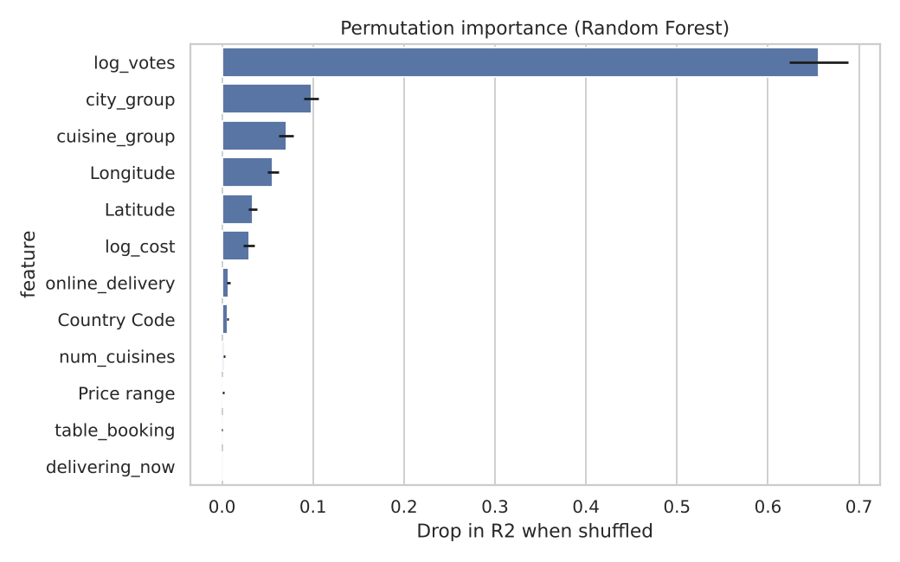
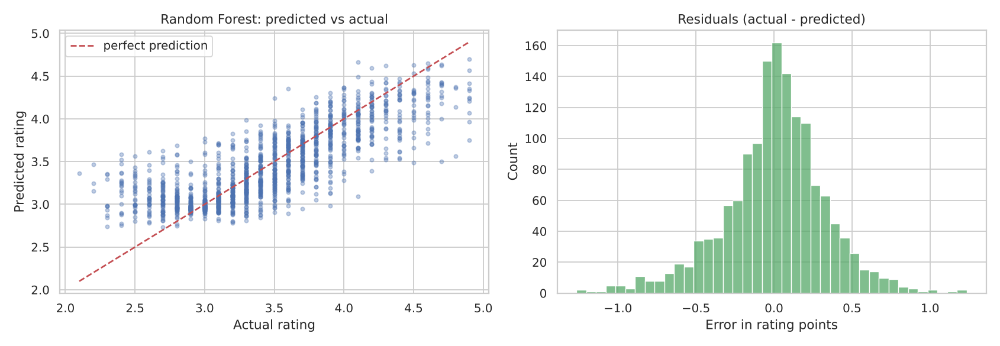
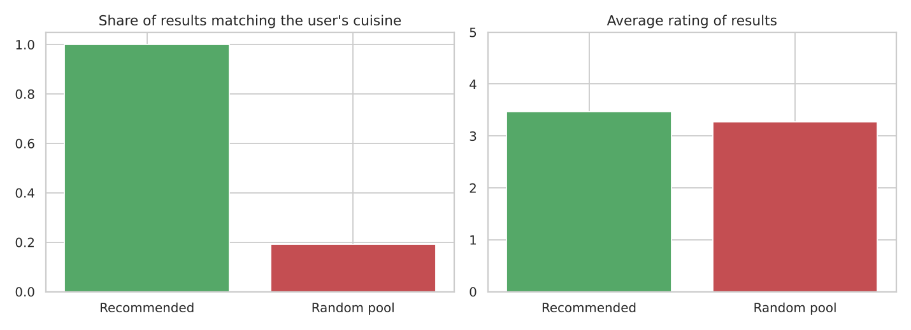
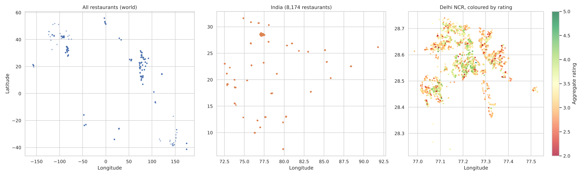
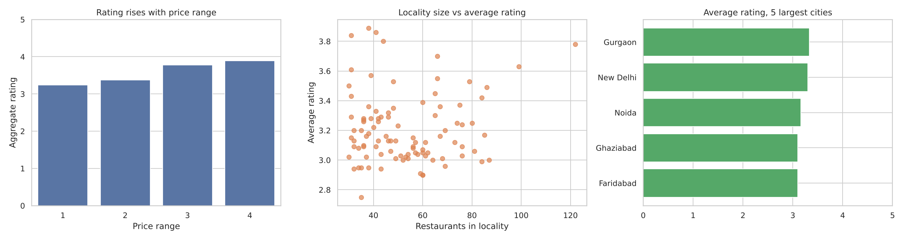

# 🍽️ Restaurant ML Analysis

**Predicting ratings, recommending restaurants, and mapping where the food is** — three end-to-end machine learning mini-projects on a dataset of **9,551 restaurants across 15 country codes and 141 cities**.


Built as part of a Machine Learning internship task list (3 of 4 tasks completed). Every notebook is fully executed, so you can read the results on GitHub without running anything.

---

## ✨ At a glance

| # | Project | What it does | Headline result |
|---|---------|--------------|-----------------|
| 1 | [**Rating Prediction**](Task1_Restaurant_Rating_Prediction.ipynb) | Regression: predict a restaurant's rating from its features | Random Forest, **R² 0.65**, average error **0.24 stars** |
| 2 | [**Recommendation Engine**](Task2_Restaurant_Recommendation.ipynb) | Content-based recommender (cuisine, city, price, quality) + "more like this" | **100%** constraint-valid results, cuisine match **100% vs 19%** for random |
| 3 | [**Location Analysis**](Task4_Location_Analysis.ipynb) | Maps, city/locality statistics, concentration and patterns | **83%** of restaurants sit in Delhi NCR; price and rating move together |

---

## 1️⃣ Predicting restaurant ratings

**Question:** can we predict a restaurant's rating from things like city, cuisine, price, votes and location?

| Model | R² (test) | RMSE | MAE |
|-------|-----------|------|-----|
| **Random Forest** | **0.652** | 0.328 | 0.243 |
| Gradient Boosting | 0.640 | 0.334 | 0.250 |
| Linear Regression | 0.609 | 0.348 | 0.261 |
| Decision Tree | 0.573 | 0.364 | 0.271 |
| Baseline (always predict the mean) | 0.000 | 0.556 | 0.455 |

- **69.6%** of predictions land within ±0.3 of the true rating, **88%** within ±0.5.
- **Votes** is by far the strongest signal (permutation importance 0.66, next best 0.10), followed by city, cuisine and location.
- ⚠️ Votes measures *popularity*, not quality, and only exists after people have reviewed a place. **Without votes the model drops to R² 0.54**, which is the honest estimate for a brand-new restaurant.

<p align="center">
  
  
</p>

**Data traps handled (they silently ruin naive models):**
- A rating of **0 means "not rated"**, not "terrible". 2,148 such rows (22.5%) were excluded.
- `Rating text` and `Rating color` are the target in disguise (**data leakage**), so they were dropped.
- Costs are in 12 different currencies, so cost is never compared across countries.
- 497 rows have placeholder `(0, 0)` coordinates, treated as missing.
- Train/test split happens *before* preprocessing so no test information leaks into training.

---

## 2️⃣ Restaurant recommendation engine

A **content-based** recommender: you say what you like, it finds matching restaurants.

```python
recommend(["North Indian", "Mughlai"], city="New Delhi", price_range=2, min_rating=4.0)
similar_to("Barbeque Nation", city="New Delhi")      # "more like this"
```

**How it scores:** hard filters first (city, price range, rating, votes, delivery, table booking), then
`score = 0.65 × cuisine match (Jaccard) + 0.20 × rating + 0.15 × price closeness`.

**Tested on 300 simulated users:**

| Check | Result |
|-------|--------|
| Results respect city and price filters | **100%** |
| Requests that return a full list of 10 | **94.7%** |
| Results matching the user's cuisine | **100%** (vs **19.2%** for a random pick from the same pool) |
| Average rating of results | **3.47** (vs 3.28 for random) |

Also handles typos with suggestions (`"North Indain"` → `north indian`), unknown cities, and impossible requests without crashing.

> **Honest limit:** the dataset has no user history (clicks/orders), so real-world accuracy can't be measured. These checks show the logic is correct and adds value over random, not that real users will love the picks.

<p align="center"></p>

---

## 3️⃣ Location-based analysis

<p align="center"></p>

**What the data shows**
- **Delhi NCR holds 83.2%** of all restaurants (New Delhi 57%, Gurgaon 12%, Noida 11%).
- Inside cities the spread is thin: the top 10 of 1,265 localities hold only 9.3% of restaurants. **Connaught Place** is the densest hub (122 restaurants).
- Best-rated areas are mall/office/high-street hubs: **Sector 29 Gurgaon (3.89), Cyber Hub (3.86), DLF Mall of India Noida (3.84), Khan Market (3.80)**.
- Average rating rises with price range: **3.24 → 3.89** from the cheapest to the priciest tier (Spearman 0.40). Restaurants with table booking rate higher (3.59 vs 3.41).
- Locality size has **no relationship** with rating (Spearman −0.03).

<p align="center"></p>

**A warning worth knowing:** outside Delhi NCR the file holds only ~20 popular restaurants per city (136 cities, ~4× the average votes), so "other cities rate higher" mostly reflects *which restaurants were collected*, not that NCR food is worse. Other data issues found: wrong GPS points (including one test record), and a mislabelled currency for one country code.

Interactive maps (download and open in a browser): [`task4_heatmap.html`](task4_heatmap.html) · [`task4_top_rated_map.html`](task4_top_rated_map.html)

---

## 🚀 Run it yourself

```bash
git clone https://github.com/<your-username>/restaurant-ml-analysis.git
cd restaurant-ml-analysis
pip install -r requirements.txt
jupyter notebook
```

1. Place the dataset file in the project folder and name it **`Dataset.csv`** (it is not redistributed in this repo).
2. Open a notebook and choose **Run All**.

> Results can differ in the third decimal depending on your library versions (for example R² 0.652 vs 0.654). The conclusions stay the same.

---

## 🗂️ Repository structure

```
restaurant-ml-analysis/
├── Task1_Restaurant_Rating_Prediction.ipynb
├── Task2_Restaurant_Recommendation.ipynb
├── Task4_Location_Analysis.ipynb
├── task1_*.png / task2_*.png / task4_*.png   # charts
├── task*_*.csv                               # model comparison, city/locality statistics
├── task4_heatmap.html, task4_top_rated_map.html   # interactive maps
├── requirements.txt
└── README.md
```

## 🧰 Tech stack
Python · pandas · NumPy · scikit-learn (Pipelines, GridSearchCV, permutation importance) · matplotlib · seaborn · SciPy · folium

## ⚠️ Limitations
- Ratings explained only partly (R² 0.65): food quality, service and ambience are not in the data.
- The recommender is content-based and cannot learn hidden tastes; chains appear once per branch.
- Geographic coverage is uneven (see the Location Analysis warning), so cross-city comparisons outside Delhi NCR are unreliable.

---

## 👤 Author
**Manish Chandra Raturi**
🔗 LinkedIn: _add your link_ · 💻 GitHub: _add your link_ · ✉️ _add your email_
